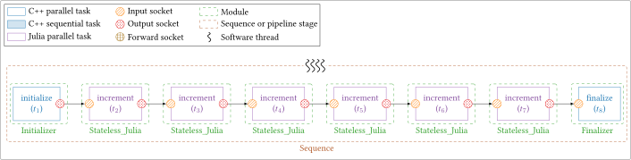
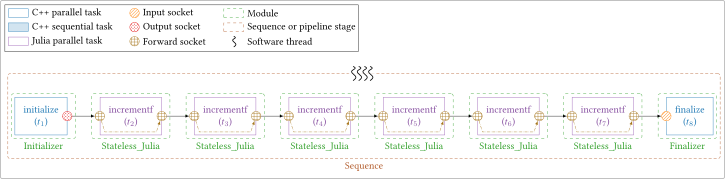
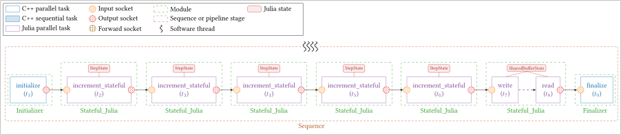
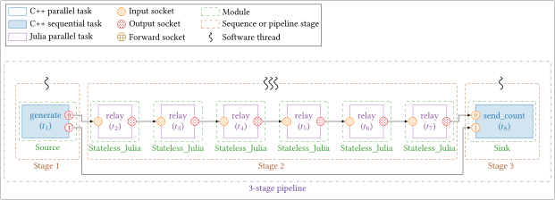
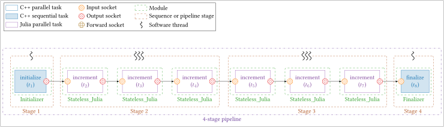
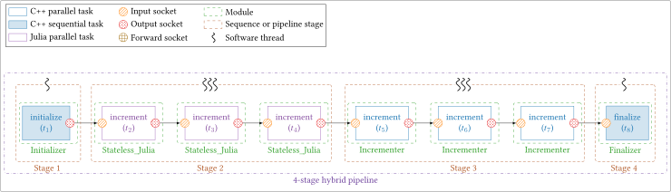

# Julia Interoperability

`StreamPU` provides native, zero-copy, multi-threaded interoperability with the
[Julia programming language](https://julialang.org/) through Julia's C API
(`libjulia`). This allows users to write signal-processing or numerical tasks
directly in Julia while relying on `StreamPU` to orchestrate dataflow buffers,
inter-frame batching, multi-threaded `Sequence` replication, and multi-stage
`Pipeline` execution alongside C++ modules.

!!! warning
    To use Julia modules, Julia must be installed on the system and `StreamPU`
    must be compiled with the `SPU_JULIA` preprocessor definition via the
    following CMake option:
    ```bash
    cmake -S . -B build -DSPU_LINK_JULIA=ON
    ```
    Multi-threaded execution requires Julia's `jl_adopt_thread` C API feature
    (introduced in Julia 1.9). `StreamPU` has been tested from **Julia 1.10 to
    Julia 1.13**.

---

## Basics

### Runtime Initialization

Before instantiating or evaluating any Julia module, initialize the Julia
runtime once at the start of `main()` via `spu::tools::Julia::init()`:

```cpp
#include <streampu.hpp>
using namespace spu;

int main(int argc, char** argv)
{
    tools::Signal_handler::init();
    tools::Julia::init(256); // starts libjulia if needed and allocates 256 GC root slots per thread

    // ... build and execute StreamPU sequences or pipelines ...

    tools::Julia::exit(0);   // optional: runs Julia atexit hooks before returning
    return 0;
}
```

!!! note
    `tools::Julia::init()` automatically calls `jl_init()` if the Julia engine
    is not already running, compiles `StreamPU`'s internal GC-rooting helpers,
    and **preserves any pre-existing `SIGINT` handler** (such as
    `tools::Signal_handler::init()`) so `Ctrl+C` cleanly interrupts running
    sequences and pipelines.

---

### Stateless Modules (`Stateless_Julia`)

Use `spu::module::Stateless_Julia` for pure dataflow tasks that only depend on
their input/output/forward sockets and scalar constants:

```cpp
module::Stateless_Julia incr;
runtime::Task& t = incr.create_task("increment");
incr.create_socket_in<uint8_t>(t, "in", data_length);
incr.create_socket_out<uint8_t>(t, "out", data_length);
incr.create_constant<uint32_t>(t, step_value);

incr.create_codelet(t, R""""(
    function increment(sck_in, sck_out, cst_step, rnt_frame_id, rnt_n_frames_per_wave)
        step = eltype(sck_in)(cst_step)
        @inbounds for n in eachindex(sck_in)
            sck_out[n] = sck_in[n] + step
        end
        return 0
    end
)"""");
```

#### Codelet Argument Convention

Every `Stateless_Julia` codelet receives its arguments in the exact registration
order below and must return an integer status code (`0` for
`runtime::status_t::SUCCESS`):

```julia
function <task_name>(sck_1, ..., sck_M, cst_1, ..., cst_K, rnt_frame_id, rnt_n_frames_per_wave)
    # ...
    return 0
end
```

1. **Sockets (`sck_1, ..., sck_M`)**: Zero-copy 1D Julia `Vector{T}`
   (`Array{T, 1}`) views wrapped directly around `StreamPU`'s C++ socket
   buffers (`1`-based indexing in Julia).
2. **Constants (`cst_1, ..., cst_K`)**: Scalar values registered on the task via
   `create_constant<T>(t, val)`.
3. **`rnt_frame_id` (`UInt32`)**: `0`-based index of the starting frame for the
   current wave execution (`0` when `n_frames == 1` or in single-wave mode).
4. **`rnt_n_frames_per_wave` (`UInt32`)**: Number of frames processed per
   codelet call.

---

### Stateful Modules (`Stateful_Julia`)

Use `spu::module::Stateful_Julia` when tasks require persistent Julia objects
across invocations (such as filter histories, counters, lookup tables, or
pre-allocated scratch workspaces):

```cpp
module::Stateful_Julia filter;
filter.create_state("MyConfig(0.95f0)", /*shared=*/true, R""""(
    struct MyConfig
        alpha::Float32
    end
)"""");
filter.create_state("MyWorkspace(zeros(Float32, 1024))", /*shared=*/false, R""""(
    mutable struct MyWorkspace
        history::Vector{Float32}
    end
)"""");

runtime::Task& t = filter.create_task("process");
filter.create_socket_in<float>(t, "in", 1024);
filter.create_socket_out<float>(t, "out", 1024);
filter.create_codelet(t, R""""(
    function process(cfg::MyConfig, ws::MyWorkspace, sck_in, sck_out, rnt_frame_id, rnt_n_frames_per_wave)
        α = cfg.alpha
        @inbounds for i in eachindex(sck_in)
            y = (1.0f0 - α) * sck_in[i] + α * ws.history[i]
            ws.history[i] = y
            sck_out[i] = y
        end
        return 0
    end
)"""");
```

- **Argument order**: Registered state objects (`stt_1, ..., stt_S`) are
  **prepended before the socket arguments** when invoking any task belonging to
  that `Stateful_Julia` module. Multiple tasks within the same module share the
  module's state instances.
- **Cloning semantics (`shared = false` vs. `shared = true`)**:
    - `shared = false` *(default)*: When `Sequence` or `Pipeline` clones the
      module across worker threads, each clone receives an independent
      `Base.deepcopy` of the Julia state, guaranteeing lock-free thread safety for
      mutable workspaces.
    - `shared = true`: Clones keep a shallow reference to the exact same Julia
      object in memory, avoiding redundant duplication of large immutable data
      structures (e.g., great for constants).

---

### Loading Codelets & Exception Safety

=== "Inline Julia String"

    ```cpp
    mod.create_codelet(t, R""""(
        function my_task(sck_in, sck_out, rnt_frame_id, rnt_n_frames_per_wave)
            sck_out .= sck_in
            return 0
        end
    )"""");
    ```
    By default, `StreamPU` looks up a Julia function matching `t.get_name()`. An
    explicit third argument `create_codelet(t, code, "custom_func_name")` can
    override the function name.

=== "External `.jl` File"

    ```cpp
    // For states (Stateful_Julia only):
    mod.create_state_file("StepState(1, 0)", /*shared=*/false, "path/to/states.jl");

    // For codelets:
    mod.create_codelet_file(t, "path/to/codelets.jl");
    ```
    Evaluates the external `.jl` file and binds the task to `t.get_name()` (or
    to an optional third argument `julia_function_name`).

=== "Pre-Evaluated Function"

    ```cpp
    tools::Julia::eval_file("path/to/codelets.jl");

    // Looks up t.get_name() in StreamPU's Julia context without re-evaluating code:
    mod.create_codelet(t);
    ```
    Ideal when multiple modules or tasks live in a single `.jl` file evaluated
    once at startup.

#### Safe vs. Unsafe Invocation (`set_jl_safety`)

- **`mod.set_jl_safety(true)`** *(default)*: Invokes codelets inside a Julia
  `try ... catch` wrapper (`StreamPU.safe_call`). Any uncaught Julia exception
  is formatted with its full Julia stacktrace and rethrown in C++ as a
  `spu::tools::runtime_error`. Recommended during development and debugging.
- **`mod.set_jl_safety(false)`**: Calls `jl_call` directly without exception
  wrapping, reducing C++-to-Julia call overhead below ~100 ns. Recommended for
  validated hot loops and benchmarks.

---

### Performance & Multi-Threading Best Practices

!!! tip "Guidelines for High-Throughput Multi-Threaded Execution"
    1. **Let `StreamPU` manage threads**: `Sequence` and `Pipeline`
       automatically run stages containing Julia modules on `Thread_pool_Julia`
       (adopting C++ worker threads via `jl_adopt_thread()` and entering
       `GC_SAFE` while waiting on barriers or inter-stage buffers), while pure
       C++ stages run on `Thread_pool_standard`. Do **not** use
       `Threads.@threads` or Julia task-switching I/O (such as `println`) inside
       codelets running on adopted threads.
    2. **Zero heap allocation in codelets**: Mutate output/forward sockets
       in-place and pre-allocate temporary arrays inside a `Stateful_Julia`
       workspace (`shared = false`) so hot loops do not trigger stop-the-world
       GC sweeps.
    3. **JIT warmup & `precompile`**: The first execution compiles Julia methods
       with LLVM. Run a warmup iteration or add explicit `precompile(my_task,
       (...))` directives at the bottom of your `.jl` files before measuring
       latency or throughput.

---

## Validation Tests & Examples

`StreamPU` includes dedicated Julia tests in the `tests/julia` directory (built
into `./bin/` when `-DSPU_LINK_JULIA=ON` and `-DSPU_TESTS=ON` are enabled). They
serve both as validation suites and as complete working templates.

### Simple Stateless Chains

Mirroring the C++ bootstrap chains, these two tests chain an `Initializer`
($t_1$), six `Stateless_Julia` incrementers ($t_{[2:7]}$) that each add "$+1$"
to every byte in the frame, and a `Finalizer` ($t_8$) that verifies the output
equals the initial values "$+6$" across all threads and inter-frames. Both
support `-J` (`--jl-safe`) to test safe exception wrapping and `-E`
(`--jl-extern`) to load codelets from `tests/julia/codelets.jl`.

=== "With Input and Output Sockets"

    <figure markdown>
      { width="1000" }
    </figure>
    ```bash
    ./bin/test-simple-chain-julia -t 4 -e 10000
    ```
    Each `Stateless_Julia` module exposes an `increment` task with one input
    socket (`in`) and one output socket (`out`). Source code:
    `tests/julia/simple_chain_julia.cpp`.

    **Command Line Arguments**

    The following verbatim is a copy-paste from the `-h` stdout:

    ```bash
    usage: ./bin/test-simple-chain-julia [options]

      -t, --n-threads       Number of threads to run in parallel                                  [10]
      -f, --n-inter-frames  Number of frames to process in one task                               [1]
      -s, --sleep-time      Sleep time duration in one task (microseconds)                        [5]
      -d, --data-length     Size of data to process in one task (in bytes)                        [2048]
      -e, --n-exec          Number of sequence executions                                         [100000]
      -o, --dot-filepath    Path to dot output file                                               [empty]
      -c, --copy-mode       Enable to copy data in sequence (performance will be reduced)         [false]
      -b, --step-by-step    Enable step-by-step sequence execution (performance will be reduced)  [false]
      -p, --print-stats     Enable to print per task statistics (performance will be reduced)     [false]
      -J, --jl-safe         Enable Julia safe mode (throw exceptions to C++)                      [false]
      -E, --jl-extern       Evaluate the Julia code from an external file                         [false]
      -g, --debug           Enable task debug mode (print socket data)                            [false]
      -v, --verbose         Enable verbose mode                                                   [false]
      -h, --help            This help                                                             [false]
    ```

=== "With Forward Sockets"

    <figure markdown>
      { width="1000" }
    </figure>
    ```bash
    ./bin/test-simple-chain-fwd-julia -t 4 -e 10000
    ```
    Each `Stateless_Julia` module exposes an `incrementf` task with a single
    forward socket (`fwd`), mutating the shared buffer in-place (`sck_fwd[n] +=
    1`) without extra memory copies. Source code:
    `tests/julia/simple_chain_fwd_julia.cpp`.

    **Command Line Arguments**

    The following verbatim is a copy-paste from the `-h` stdout:

    ```bash
    usage: ./bin/test-simple-chain-fwd-julia [options]

      -t, --n-threads       Number of threads to run in parallel                                  [10]
      -f, --n-inter-frames  Number of frames to process in one task                               [1]
      -s, --sleep-time      Sleep time duration in one task (microseconds)                        [5]
      -d, --data-length     Size of data to process in one task (in bytes)                        [2048]
      -e, --n-exec          Number of sequence executions                                         [100000]
      -o, --dot-filepath    Path to dot output file                                               [empty]
      -c, --copy-mode       Enable to copy data in sequence (performance will be reduced)         [false]
      -b, --step-by-step    Enable step-by-step sequence execution (performance will be reduced)  [false]
      -p, --print-stats     Enable to print per task statistics (performance will be reduced)     [false]
      -J, --jl-safe         Enable Julia safe mode (throw exceptions to C++)                      [false]
      -E, --jl-extern       Evaluate the Julia code from an external file                         [false]
      -g, --debug           Enable task debug mode (print socket data)                            [false]
      -v, --verbose         Enable verbose mode                                                   [false]
      -h, --help            This help                                                             [false]
    ```

---

### Stateful Chain

This test (`tests/julia/stateful_chain_julia.cpp`) validates persistent state
management, multi-task state sharing, and independent `Base.deepcopy` state
cloning across threads in `spu::module::Stateful_Julia`.

<figure markdown>
  { width="1000" }
</figure>

```bash
./bin/test-stateful-chain-julia -t 4 -f 2 -e 10000
```

The sequence combines two stateful patterns between the `Initializer` ($t_1$)
and `Finalizer` ($t_9$):

1. **Five single-task `Stateful_Julia` modules ($t_{[2:6]}$)**: Each instance
   owns a mutable `StepState(step, calls)` initialized to `(1, 0)`. At each
   execution (`rnt_frame_id == 0`), `increment_stateful` increments
   `stt_step.calls` and adds `stt_step.step` to the frame data.
2. **One two-task `Stateful_Julia` module ($t_7, t_8$)**: Exposes both `write`
   ($t_7$, bound to `write_buf`) and `read` ($t_8$, bound to `read_buf`)
   sharing a common `SharedBufferState(buf)`:
   - `write` increments the incoming data from its `in` socket by "$+1$" and
     stores the result inside the persistent Julia buffer `stt_buf.buf` (with no
     output data socket).
   - `read` is scheduled after `write` via **task binding** (`rw("read") =
     rw("write")`) with no input data socket, and copies the frame directly out
     of `stt_buf.buf` into its `out` socket.

At the end of the run, the test checks both that the `Finalizer` values equal
the initial values "$+6$", and—by inspecting each cloned module's Julia
`StepState` via `get_states()`—that every thread mutated its own isolated state
copy whose `calls` counters sum to `n_exec`.

**Command Line Arguments**

The following verbatim is a copy-paste from the `-h` stdout:

```bash
usage: ./bin/test-stateful-chain-julia [options]

  -t, --n-threads       Number of threads to run in parallel                                  [10]
  -f, --n-inter-frames  Number of frames to process in one task                               [1]
  -s, --sleep-time      Sleep time duration in one task (microseconds)                        [5]
  -d, --data-length     Size of data to process in one task (in bytes)                        [2048]
  -e, --n-exec          Number of sequence executions                                         [100000]
  -o, --dot-filepath    Path to dot output file                                               [empty]
  -c, --copy-mode       Enable to copy data in sequence (performance will be reduced)         [false]
  -b, --step-by-step    Enable step-by-step sequence execution (performance will be reduced)  [false]
  -p, --print-stats     Enable to print per task statistics (performance will be reduced)     [false]
  -J, --jl-safe         Enable Julia safe mode (throw exceptions to C++)                      [false]
  -E, --jl-extern       Evaluate the Julia code from an external file                         [false]
  -g, --debug           Enable task debug mode (print socket data)                            [false]
  -v, --verbose         Enable verbose mode                                                   [false]
  -h, --help            This help                                                             [false]
```

---

### Multi-Stage Pipelines

This test (`tests/julia/simple_pipeline_julia.cpp`) validates
`spu::runtime::Pipeline` execution when stages contain Julia tasks, including
inter-stage adaptor synchronization, GC-safe thread waiting (`--gc-stress`), JIT
warmup (`--warmup`), and hybrid cohabitation between `Thread_pool_Julia` stages
and pure C++ `Thread_pool_standard` stages (`--hybrid`).

=== "3-Stage File I/O Pipeline"

    <figure markdown>
      { width="1000" }
    </figure>
    ```bash
    ./bin/test-simple-pipeline-julia -t 3 --in-filepath ~/.bashrc --out-filepath file_julia.out
    ```
    Activated when `--in-filepath` (`-i`) is provided:

    - **Stage 1 (1 C++ thread)**: Sequential `Source_user_binary` reading bytes
      from the input file (`generate`, $t_1$).
    - **Stage 2 (`-t` Julia threads)**: Six replicated `Stateless_Julia` `relay`
      tasks ($t_{[2:7]}$) copying frames across worker threads managed by
      `Thread_pool_Julia`.
    - **Stage 3 (1 C++ thread)**: Sequential `Sink_user_binary` (`send_count`,
      $t_8$) writing exact byte counts to disk, followed by a byte-for-byte
      comparison between the input and output files.

=== "4-Stage Pure Julia Pipeline"

    <figure markdown>
      { width="1000" }
    </figure>
    ```bash
    ./bin/test-simple-pipeline-julia -t 3 -e 1000 -W
    ```
    Default mode when `--in-filepath` is omitted:

    - **Stage 1 (1 C++ thread)**: `Initializer` ($t_1$).
    - **Stage 2 (`-t` Julia threads)**: Three `Stateless_Julia` `increment`
      modules ($t_{[2:4]}$).
    - **Stage 3 (`-t` Julia threads)**: Three `Stateless_Julia` `increment`
      modules ($t_{[5:7]}$).
    - **Stage 4 (1 C++ thread)**: `Finalizer` ($t_8$) verifying all frames equal
      initial values "$+6$".

    Adding `-G` (`--gc-stress`) allocates temporary Julia heap vectors inside
    every `increment` call across both multi-threaded Julia stages concurrently,
    validating `GC_SAFE` transitions across pipeline adaptors.

=== "4-Stage Hybrid Julia/C++ Pipeline"

    <figure markdown>
      { width="1000" }
    </figure>
    ```bash
    ./bin/test-simple-pipeline-julia -t 3 -e 1000 -H -G -W
    ```
    Activated by passing `-H` (`--hybrid`):

    - **Stage 2** runs three `Stateless_Julia` modules on `Thread_pool_Julia`
      (adopted threads coordinated with Julia's GC).
    - **Stage 3** runs three native C++ `Incrementer` modules on
      `Thread_pool_standard` (pure C++ threads completely decoupled from Julia's
      runtime and GC pauses).

**Command Line Arguments**

The following verbatim is a copy-paste from the `-h` stdout:

```bash
usage: ./bin/test-simple-pipeline-julia [options]

  -t, --n-threads       Number of threads to run in parallel                                  [10]
  -f, --n-inter-frames  Number of frames to process in one task                               [1]
  -s, --sleep-time      Sleep time duration in one task (microseconds)                        [5]
  -d, --data-length     Size of data to process in one task (in bytes)                        [2048]
  -e, --n-exec          Number of sequence executions (when no input file is given)           [100]
  -u, --buffer-size     Size of the buffer between the different stages of the pipeline       [16]
  -o, --dot-filepath    Path to dot output file                                               [empty]
  -i, --in-filepath     Path to the input file (used to generate bits of the chain)           [empty]
  -j, --out-filepath    Path to the output file (written at the end of the chain)             ["file_julia.out"]
  -c, --copy-mode       Enable to copy data in sequence (performance will be reduced)         [false]
  -b, --step-by-step    Enable step-by-step sequence execution (performance will be reduced)  [false]
  -p, --print-stats     Enable to print per task statistics (performance will be reduced)     [false]
  -g, --debug           Enable task debug mode (print socket data)                            [false]
  -q, --force-sequence  Force sequence instead of pipeline                                    [false]
  -w, --active-waiting  Enable active waiting in the pipeline synchronizations                [false]
  -k, --task-autoalloc  Enable task SOUT autoalloc mode                                       [false]
  -J, --jl-safe         Enable Julia safe mode (throw exceptions to C++)                      [false]
  -E, --jl-extern       Evaluate the Julia code from an external file                         [false]
  -H, --hybrid          Mix C++ Incrementer and Julia Stateless_Julia stages                  [false]
  -G, --gc-stress       Allocate temporary Julia arrays to stress-test multi-stage GC         [false]
  -W, --warmup          Run a 1-stream warmup execution before the main execution             [false]
  -h, --help            This help                                                             [false]
```
